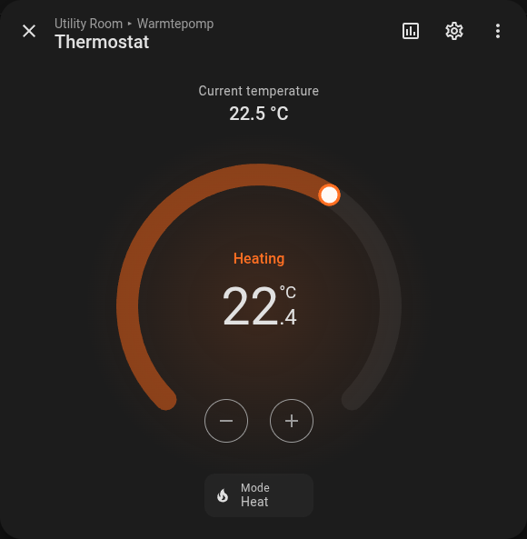
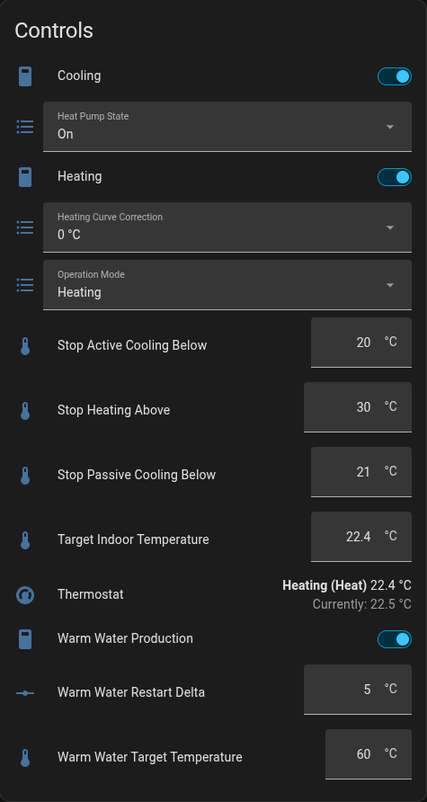
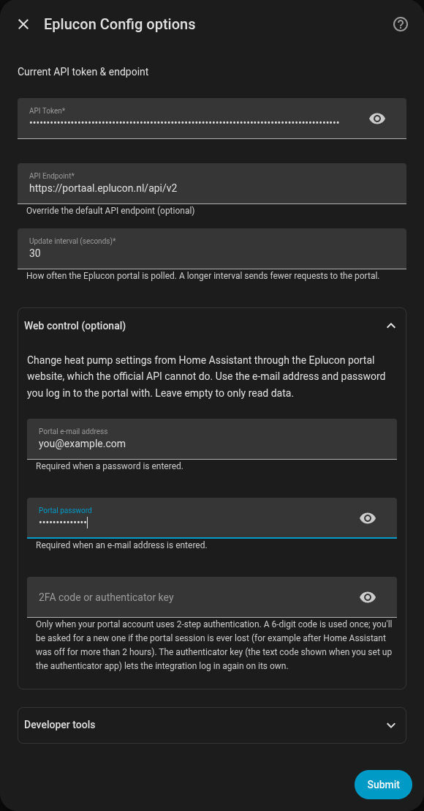
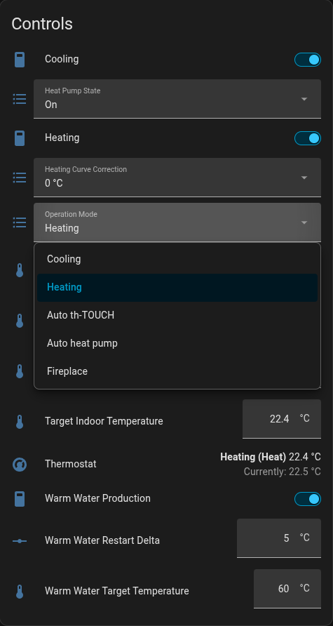

# Home Assistant Eplucon Integration

This custom integration allows you to integrate your Eplucon devices into Home Assistant, providing access to real-time data and sensor values.

<p align="center">
  
  
</p>

With [web control](#web-control-optional) on, the heat pump becomes a thermostat
in Home Assistant, and its settings can be changed from dashboards and automations.

## Features

- Monitor indoor temperature, vent RPM, brine circulation pump, and more in real-time.
- Expose per-zone control panels of a zone controller (th-TOUCH) as devices, with
  temperature, humidity, battery, signal and call-for-heat sensors (read-only).
- Automatically update sensor data using Home Assistant's update coordinator.
- Optionally control the heat pump (target temperature, operation mode, warm
  water, heating and cooling) through the Eplucon portal website.

## Installation

### HACS (Home Assistant Community Store)

1. Ensure you have [HACS](https://hacs.xyz/) installed in your Home Assistant instance.
2. Open HACS, go to the "Integrations" tab, and click on the "+" button to add a new repository.
3. Search for "Eplucon" and install the integration.
4. Restart Home Assistant.

### Manual Installation

1. Download the latest release from the [GitHub releases page](https://github.com/koenhendriks/ha-eplucon/releases).
2. Extract the `eplucon` folder into your `config/custom_components/` directory.
3. Restart Home Assistant.

## Configuration

### Step 1: Obtain API Token

To use this integration, you will need an API token from Eplucon. Follow these steps to get your token:

1. Log in to your Eplucon account.
2. Navigate to My Account and then the [API section](https://portaal.eplucon.nl/account/api_tokens).
3. Generate or copy your existing API token.

### Step 2: Add Integration in Home Assistant

1. Go to **Settings** > **Devices & Services** > **Add Integration**.
2. Search for "Eplucon" and select it.
3. Enter your API token and complete the setup.

### Step 3: Sensors and Entities

After successful setup, Home Assistant will automatically add the available sensors. You can find them under the **Devices & Services** section in Home Assistant.

## Available Sensors

This integration provides all available sensors that can be retrieved from the [Eplucon API](https://portaal.eplucon.nl/docs/api#/) and adds them to your Home Assistant. Some of the available sensors include:

- **Indoor Temperature** (°C)
- **Vent RPM** (RPM)
- **Brine Circulation Pump** (RPM)
- **Outdoor Temperature** (°C) - if available
- **Heating Status** - if applicable

These sensors are automatically created based on the real-time information available from your Eplucon device.

### Zone control panels (th-TOUCH)

If your installation includes a zone controller (`zones_system_controller`), each
regulation zone / room is added as its own device with read-only entities:

- **Temperature** (°C) and **Target Temperature** (°C)
- **Humidity** (%)
- **Battery** (%) and **Signal Strength** (%) — diagnostic
- **Mode** and **Regulation** (heating/cooling) — diagnostic
- **Call for Heat** — binary sensor (the zone relay state)

Entities are named after their zone, so a zone called *Woonkamer* yields
`sensor.woonkamer_temperature`, `sensor.woonkamer_humidity` and so on. A zone
that drops out of the API (flat control-panel battery, lost wireless link) is
reported as unavailable rather than as a zero or an `off`.

These use the same API token; no extra credentials are required. Setting a zone's
target temperature from Home Assistant is **not** supported: the Eplucon public API
is read-only for zones, and the portal's write path needs a separate web login.
See [`docs/zones-api.md`](docs/zones-api.md) for the full API investigation.

## Web control (optional)

The official Eplucon API can only read. To change heat pump settings from Home
Assistant, the integration can also log in to the portal website the way your
browser does, and use the same settings dialogs. This is optional: leave it
empty and the integration only reads, as before.

To turn it on, open the **Web control (optional)** section when adding the
integration, or later under **Configure**, and enter:

- **Portal e-mail address** and **Portal password**: what you log in to
  [portaal.eplucon.nl](https://portaal.eplucon.nl) with. Fill in both or neither.
- **2FA code or authenticator key**: only if your portal account uses 2-step
  authentication. Either the current 6-digit code from your authenticator app,
  or the authenticator key itself (the text code you can show when setting up
  the app).
  - With a **code**, the integration logs in once and keeps that portal session
    alive. If the session is ever lost (for example when Home Assistant was off
    for more than 2 hours), a repair notice asks you for a new code.
  - With the **key**, the integration makes codes itself and logs in again on
    its own. The key is stored in Home Assistant like the password.



Each heat pump then gets these entities:

| Entity | Type | Portal setting |
| --- | --- | --- |
| Thermostat | climate | Target room temperature; Off / Heat / Cool / Heat-Cool from the heat pump state and operation mode |
| Target Indoor Temperature | number | Kamer ingestelde temp. (10-30 °C) |
| Warm Water Target Temperature | number | Ingestelde temp. WW |
| Warm Water Restart Delta | number | DT setpoint |
| Stop Heating Above | number | Stop verwarmen |
| Stop Passive Cooling Below / Stop Active Cooling Below | number | Stop passief / actief koeling onder |
| Heating, Cooling, Warm Water Production | switch | Verwarming, Koeling, WW |
| Heat Pump State | select | Off, On, Emergency operation, APX |
| Operation Mode | select | Cooling, Heating, Auto th-TOUCH, Auto heat pump, Fireplace |
| Heating Curve Correction | select | -4 °C to +4 °C |



Settings are read from the portal every 5 minutes. A change shows in Home
Assistant right away and on the portal within about 20 seconds. Allowed
values come from the portal's own dialogs.

Because this uses the website rather than an API, a change to the Eplucon
website can break it. If that happens, the read-only sensors keep working;
only the web control entities become unavailable. Details of what is sent are
in [docs/web-control.md](docs/web-control.md).

### Screenshot


## Troubleshooting

### Common Issues

- **Sensor values not updating:** Ensure that your API token is correct and the Eplucon server is accessible. Check the Home Assistant logs for any errors.
- **Missing sensors:** Verify that your device supports the sensors you're trying to add. Only sensors with real-time data will be added.
- **Web control entities unavailable:** check **Settings** > **Repairs** for an Eplucon notice (wrong password, or a new 2FA code needed) and the logs for `Eplucon web control` errors.

### Logs

If you encounter any issues, check the Home Assistant logs for errors related to the Eplucon integration. Logs can be found under **Settings** > **System** > **Logs**.

Make sure to enable debug logging for this integration which can be toggled under **Settings** > **Devices & Services** > **Eplucon**.

## Development

### Mock data

Under **Developer tools** in the integration's setup and options dialog there is
a **Use mock data** switch. With it on, every value comes from the JSON fixtures
in `custom_components/eplucon/eplucon_api/mock/` instead of the Eplucon API: no
request is sent, the API token is ignored, and the API endpoint is left alone
(pointing it at a fake host only produces a DNS error). The mock account holds
one heat pump and one zone controller with five zones, so every entity type can
be worked on without a real installation. A warning is logged on every start
while the switch is on, and the section stays expanded so it can't be left
enabled unnoticed.

Each endpoint reads one fixture:

| Endpoint | Fixture |
| --- | --- |
| `/econtrol/modules` | `get_devices.json` |
| `/econtrol/modules/{id}/get_realtime_info` | `get_realtime_info.json` |
| `/econtrol/modules/{id}/heatloading_status` | `get_heatloading_status.json` |
| `/econtrol/modules/{id}/zones` | `get_zones.json` |

Fixtures are re-read on every refresh, so editing one shows up in Home Assistant
within the next update interval — no restart needed. Two optional extras help
model a less tidy account:

- **Per-module fixtures:** `get_zones.1007331.json` is used for module `1007331`
  and takes precedence over `get_zones.json`.
- **Non-200 responses:** add `"http_status": 406` to a fixture to mock an error
  response, for example a module that is not a zone controller.

With mock data on, web control needs no portal either: fill in any e-mail
address and password and the settings dialogs come from
`mock/webcontrol/modal_<code>.json` (real dialogs, anonymised). Changes are kept
in memory until Home Assistant restarts.

### Testing web control against the real portal

`scripts/webcontrol_probe.py` (read-only) and `scripts/webcontrol_live.py`
(reads, and with `set` changes a real setting) use credentials from a
`prod.env` file in the repository root, which is gitignored:

```
EPLUCON_EMAIL=you@example.com
EPLUCON_PASSWORD=...
EPLUCON_TOTP_KEY=...   # only for accounts with 2-step authentication
```

## Contributing

Contributions are welcome! If you'd like to contribute to this integration, please fork the repository and submit a pull request. Be sure to follow the existing coding style and add appropriate tests.

## Support

If you have any issues or feature requests, please open an issue on the [GitHub Issues page](https://github.com/your-repo/eplucon/issues).

## License

This project is licensed under the MIT License. See the [LICENSE](LICENSE) file for details.
